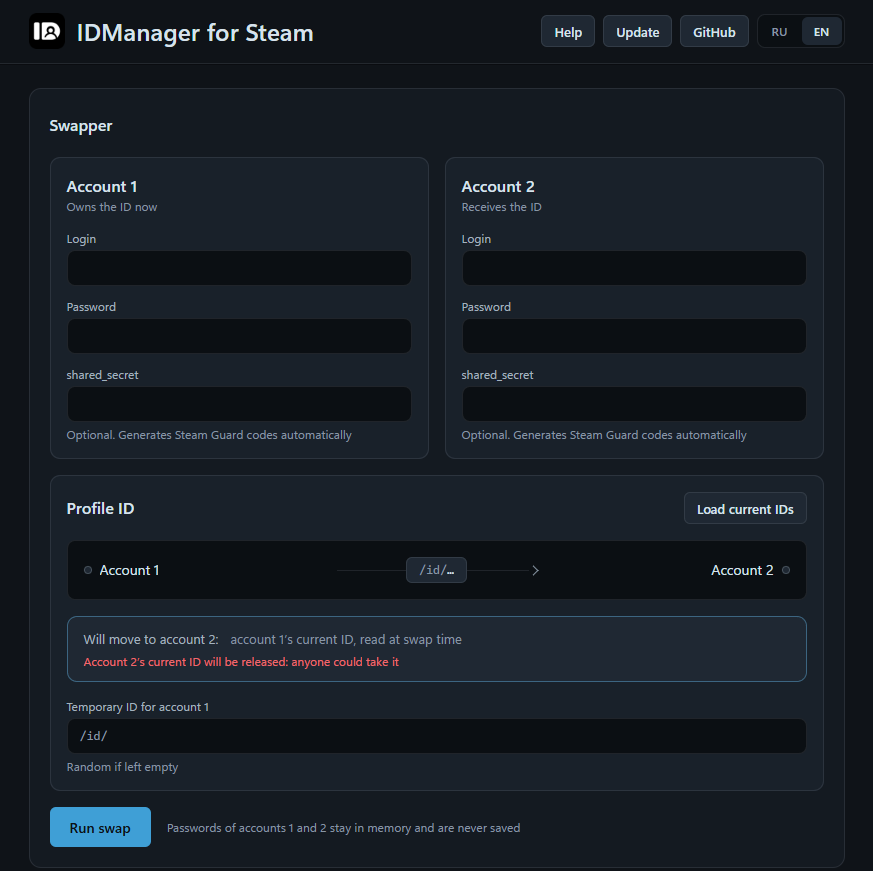
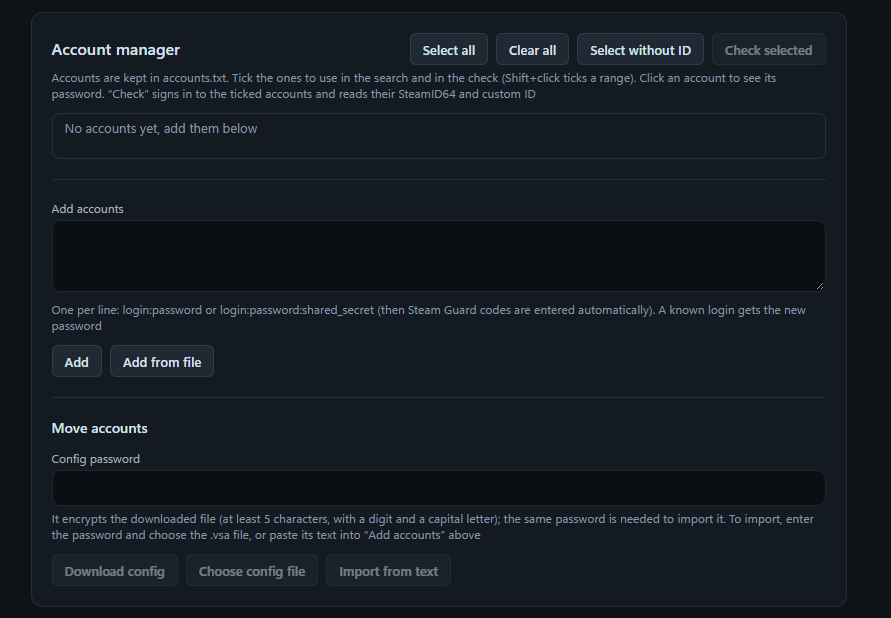
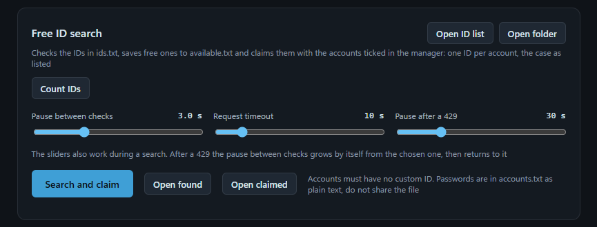

# IDManager for Steam

[English](#idmanager-for-steam) · [Русский](#ru)

Portable Windows app (Electron) for managing Steam custom profile URLs (`steamcommunity.com/id/<name>`):

- **Swapper** – transfers a custom ID from account 1 to account 2 as fast as possible; validation checks run only after the swap so nothing slows it down.
- **Account manager** – reads accounts from `accounts.txt`, fetches each account's SteamID64 and current custom ID, and exports/imports an encrypted config (`.vsa`).
- **Free ID search** – checks IDs from `ids.txt`, saves available ones to `available.txt`, and claims them with the next account that doesn't have a custom ID yet (`claimed.txt` logs who took what).

UI languages: English (default) and Russian.

> Not affiliated with Valve. Automating Steam accounts may violate the Steam Subscriber Agreement and can get accounts restricted. Use only on accounts you own, at your own risk.

## Screenshots







## Usage

Grab `IDManager-for-Steam.exe` from the [Releases](https://github.com/idLorem/IDManager-for-Steam/releases/latest) page and run it – no installer needed. Next to the executable, it creates:

| File | Purpose |
|------|---------|
| `accounts.txt` | `login:password` or `login:password:shared_secret`, one per line. **Plain text – keep it private.** |
| `accounts_info.json` | Cached account info (SteamID64, custom ID); no passwords stored here |
| `ids.txt` | IDs to check (one per line or comma-separated; case-sensitive) |
| `available.txt` | Free IDs found during search |
| `claimed.txt` | `ID:login` log of claimed IDs |

Credentials entered into the Swapper card stay in RAM only and are never written to disk.
Config exports are encrypted with AES-256-GCM (scrypt-derived key); the password must be 5+ characters with at least one digit and one uppercase letter.

Windows SmartScreen or your antivirus may flag the `.exe` because it isn't code-signed.

## Build

```bash
npm install
npm test          # offline tests against a mocked Steam backend
npm start         # run from source
npm run build     # dist/IDManager-for-Steam.exe (portable)
```

**Update** compares the latest GitHub release tag (`vX.Y.Z`) with `version` in `package.json` and opens the release page in your browser if a newer build is out (nothing is overwritten automatically). It also checks on startup unless you uncheck the box at the bottom of the window. The repository URL is defined by the `REPO` constant in `main.js`.

## Known issues

- `npm audit` flags vulnerabilities in legacy transitive dependencies pulled in by `steamcommunity` / `steam-user` (`request`, `cheerio 0.22`, `protobufjs`, …). The app only talks to Steam endpoints, though it's worth keeping in mind.
- Steam occasionally returns `"An error occurred while setting account details"` even when the ID change actually went through; the app re-fetches the profile to verify the real result.
- Tested primarily against a Steam mock – real-world rate limits and throttling can behave differently.

## License

MIT, see [LICENSE](LICENSE).

---

<a id="ru"></a>

# IDManager for Steam (по-русски)

[English](#idmanager-for-steam) · [Русский](#ru)

Портативная утилита на Electron (Windows) для работы с кастомными ссылками профиля Steam (`steamcommunity.com/id/<name>`):

- **Swapper** – максимально быстро перекидывает кастомный ID с первого аккаунта на второй; все проверки идут уже после переноса, чтобы не терять время.
- **Менеджер аккаунтов** – держит базу в `accounts.txt`, подтягивает SteamID64 и текущий ID, экспортирует и импортирует зашифрованный конфиг (`.vsa`).
- **Поиск свободных ID** – прогоняет список из `ids.txt`, свободные складывает в `available.txt` и занимает следующим аккаунтом без своего ID (`claimed.txt` – лог того, кто что забрал).

Интерфейс на английском (по умолчанию) и русском. Скриншоты – [выше](#screenshots).

> Проект никак не связан с Valve. Автоматизация аккаунтов может нарушать Соглашение подписчика Steam и привести к ограничениям. Используйте только на своих аккаунтах и на свой страх и риск.

## Использование

Скачайте `IDManager-for-Steam.exe` из [Releases](https://github.com/idLorem/IDManager-for-Steam/releases/latest) и запустите – установка не нужна. Рядом с `.exe` появятся рабочие файлы (`accounts.txt`, `accounts_info.json`, `ids.txt`, `available.txt`, `claimed.txt`); `accounts.txt` лежит в открытом виде, никому его не скидывайте. Данные аккаунтов 1 и 2 из карточки Swapper на диск не пишутся и живут только в оперативной памяти. Пароль от конфига: от 5 символов, с цифрой и заглавной буквой. SmartScreen и антивирусы могут ругаться, так как у `.exe` нет цифровой подписи.

## Сборка

```bash
npm install
npm test
npm run build
```

Кнопка «Обновление» сверяет тег последнего релиза на GitHub с версией программы и открывает страницу релиза в браузере, если есть версия новее (автозамены файлов нет). Проверка срабатывает и при запуске – отключается галочкой внизу окна. Адрес репозитория зашит в константе `REPO` в `main.js`.

## Лицензия

MIT, см. [LICENSE](LICENSE).
